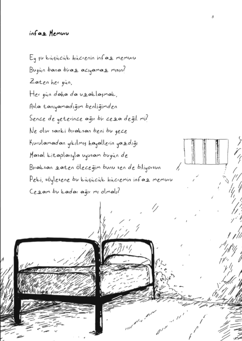

Bu proje, Python ve Tkinter kullanılarak geliştirilmiş, etkileşimli bir odadan kaçış (escape room) oyunudur. Oyuncu, kim olduğunu hatırlamadığı küçük bir hapishane hücresinde uyanır ve etrafındaki ipuçlarını takip ederek kilitli kapıyı açmaya çalışır.

Karakterimiz paslı demirleri olan bir yatak, kırık bir ayna, kilitli demir bir kapı ve dağılmış kitapların olduğu soğuk bir hücrededir. Odada yer alan "infaz Memuru" adlı şiir ve yanındaki eskiz çizim, özgürlüğe giden tek yoldur.

KontrollerSağ Ok / Sol Ok: Odanın köşeleri arasında gezinmek için.   
Yukarı Ok / Aşağı Ok: Tavana veya zemine bakmak için.   
Boşluk (Space): Baktığınız yöndeki nesneleri incelemek ve etkileşime girmek için. 

Oyunu hızlıca bitirmek için;
1. ➡️ `Sağ Ok` (Aynaya dön)
2. ➡️ `Sağ Ok` (Kitaplara dön)
3. ␣ `Boşluk` (Şiiri fark et)
4. ␣ `Boşluk` (Şiiri oku ve ipucunu al)
5. ⬅️ `Sol Ok` (Kağıttan çık ve aynaya dön)
6. ⬅️ `Sol Ok` (Yatağa geri dön)
7. ␣ `Boşluk` (Yatağı incele ve anahtarı al)
8. ⬅️ `Sol Ok` (Kapıya dön)
9. ␣ `Boşluk` (Kapıyı aç ve kaç!)

## İlham Kaynağı
Bu oyunun atmosferi, hikayesi ve bulmaca mekanikleri, aşağıdaki "İnfaz Memuru" adlı şiirden ve dijital çizimden ilham alınarak tasarlanmıştır:
_Resimde tkinter ile çizilmiş resimlerin en başta nasıl görünmesinin amaçlandığını görebilirsiniz_ 

